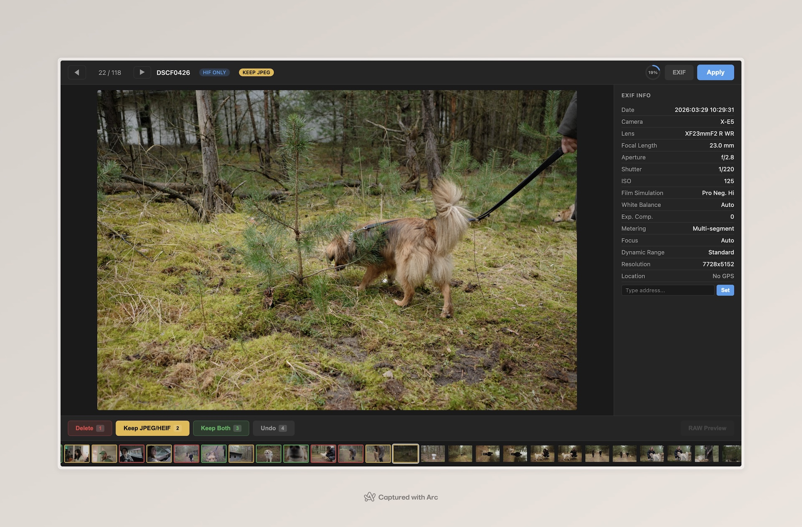

# RAW Triage

A local web-based tool for quickly triaging standalone or paired RAW + JPEG/HEIF photo files. Built for Fujifilm shooters who shoot RAW+JPEG and want a fast way to decide what to keep.

 

## What it does

Point it at a folder of photos and it opens a browser-based image viewer. For each photo you can mark it one of:

- **Delete** — all associated files (RAW + JPEG/HEIF + WAV memo) go to a `_triage_trash/` subfolder
- **Keep JPEG/HEIF** — trash the RAW, keep the JPEG/HEIF and any WAV memo
- **Keep Both** — move the RAW to an archive folder, keep the JPEG/HEIF in place

Once you've triaged everything, hit **Apply** to execute all decisions at once.



## Features

- Side-by-side RAW vs JPEG comparison (toggle with `T`)
- Click-to-zoom at 100% for checking focus, with drag-to-pan
- EXIF display (camera, lens, aperture, shutter speed, ISO, film simulation, etc.)
- GPS coordinates with Apple Maps links
- Address-based geotagging (requires `exiftool`)
- Audio memo playback for voice memos (`.wav`)
- Filmstrip thumbnail strip with lazy loading
- Full keyboard-driven workflow
- Undo support
- Image and voice memo files are grouped by filename

## Keyboard shortcuts

| Key | Action |
|-----|--------|
| `1` | Delete |
| `2` | Keep JPEG/HEIF |
| `3` | Keep Both |
| `4` | Undo |
| `T` | Toggle RAW / JPEG view |
| `Z` | Toggle 100% zoom |
| `I` | Toggle EXIF panel |
| `M` | Play/stop audio memo |
| `←` `→` `Space` | Navigate |
| `Enter` | Apply decisions |

## Setup

```bash
python3 -m venv .venv
source .venv/bin/activate
pip install -r requirements.txt
```

Optional: install [exiftool](https://exiftool.org/) for richer EXIF data and geotagging support.

## Usage

```bash
python triage.py /path/to/photos/Import
```

Options:

```
--archive FOLDER   Archive folder for kept RAWs (default: sibling 'archive' folder)
--port PORT        Server port (default: 8080)
--no-browser       Don't auto-open the browser
```

Example with explicit archive:

```bash
python triage.py ~/Photos/RAWs/Import --archive ~/Photos/RAWs/Archive
```

## Supported formats

- **RAW:** `.raf` (Fujifilm)
- **Lossy:** `.jpg`, `.jpeg`, `.hif`, `.heif`, `.heic`
- **Audio:** `.wav` (voice memos)

## Dependencies

- [Flask](https://flask.palletsprojects.com/) — web server
- [rawpy](https://github.com/letmaik/rawpy) — RAW file processing
- [Pillow](https://python-pillow.org/) — image manipulation
- [pillow-heif](https://github.com/bigcat88/pillow_heif) — HEIC/HEIF support
- [geopy](https://github.com/geopy/geopy) — address geocoding

## License

MIT
